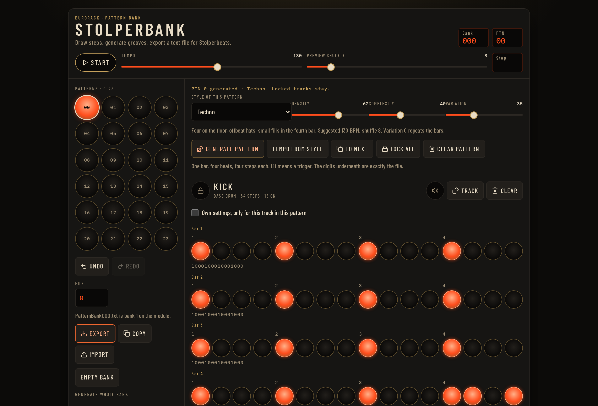
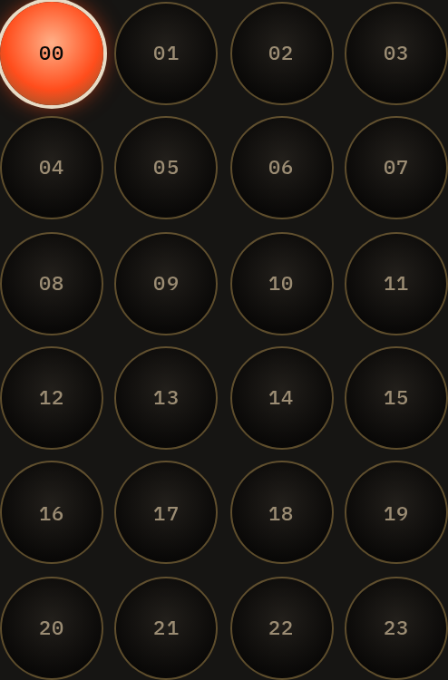
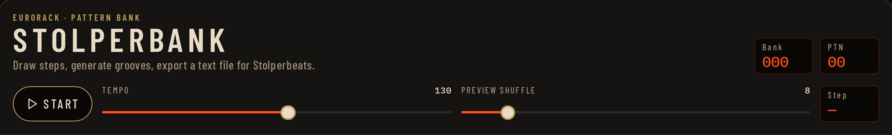
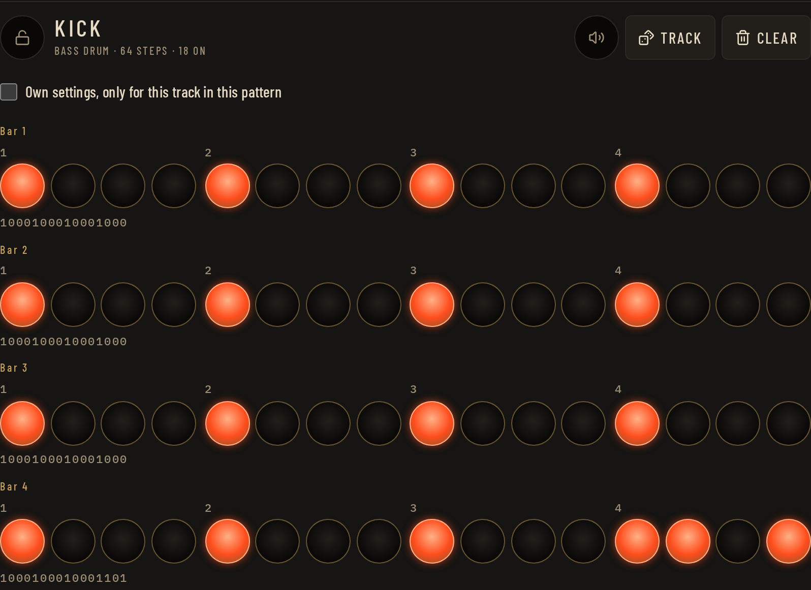
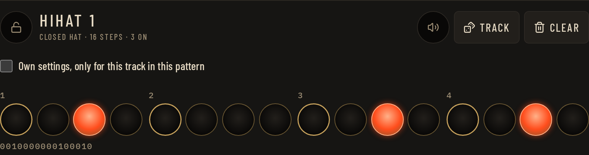
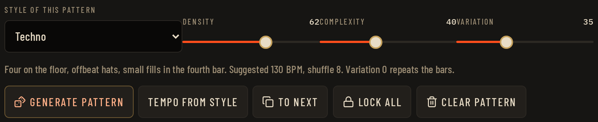
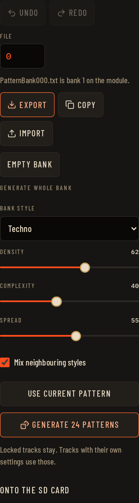

# Stolperbank

A vide-coded pattern-bank editor for the Stolperbeats eurorack sequencer by Making Sound Machines.

It lives here: [https://gordonbleu-modular.github.io/stolperbank/](https://gordonbleu-modular.github.io/stolperbank/)

For more infos on the module, see the Making Sound Machines website: [https://makingsoundmachines.com/stolperbeats/](https://makingsoundmachines.com/stolperbeats/)

# Short Tutorial:

Stolperbank writes pattern files for the Stolperbeats Eurorack sequencer. You draw or generate drum patterns, listen to them in the browser, and export a text file the module can read from its SD card.

A bank holds 24 patterns, numbered 00 to 23. Each pattern has six tracks:

| Track | On the module | Length |
|---|---|---|
| Kick | Bass drum | 64 steps, four bars |
| Snare | Snare | 64 steps, four bars |
| Hihat 1 | Closed hat | 16 steps, one bar |
| Hihat 2 | Open hat, or a rare accent | 16 steps, one bar |
| Perc 1 | Extra accent | 16 steps, one bar |
| Perc 2 | Second layer | 16 steps, one bar |

The short tracks loop four times while kick and snare play through. A lit step is a hit. The `0` and `1` digits under each bar are exactly what goes into the file.

The left column is the bank. The top bar is playback. The rest of the page is the pattern you are editing.

## 1. Choose a pattern

Click a pad to edit that pattern. The glowing pad is the current one, and the same number is shown as **PTN** in the top right. A bank you have just opened is empty, so every pad is dark until you draw or generate something.

## 2. Listen

**Start** plays the current pattern. The space bar does the same. **Tempo** and **Preview shuffle** are only for this preview. Shuffle pulls the off-beat steps late so you can hear a groove, but Stolperbeats does not store it. Timing and feel are set on the module. The step counter shows where the playhead is.

The speaker button on a track mutes it in the preview only. It does not change the file.

## 3. Draw steps

- Click a step to turn it on or off.
- Drag across steps to paint several at once.
- Shift-click a step to set that whole beat (the four steps under one number).

**Track** writes a new rhythm for that track only. **Clear** turns every step on that track off. The lock, at the left of the track name, protects it from the generator. A locked track is left as you drew it.

Tick **Own settings** if this track should use a different style, density, or complexity from the rest of the pattern.

## 4. Generate one pattern

Pick a style. The line underneath says what that style is aiming for, and suggests a tempo. Styles are grouped into Techno, House, Hip-Hop, Breaks, Groove, Latin, and a few others (jazz, IDM, ambient).

- **Density** is how many steps are on. Low is sparse, high is busy.
- **Complexity** adds off-beats and small fills.
- **Variation** changes bars 2–4 of kick and snare. At 0, those bars repeat bar 1.

**Generate pattern** rewrites the pattern you are on. Locked tracks stay. **Tempo from style** copies the suggested tempo and shuffle into the preview. **To next** copies this pattern onto the next pad, so you can keep one groove and vary it. **Lock all** protects every track. **Clear pattern** asks you to confirm, then turns the whole pattern off.

Generate again if you want another take. The same settings do not always produce the same rhythm. **Undo** and **Redo** are on the left.

## 5. Fill all 24 patterns

**Generate 24 patterns** fills every pad. It asks you to confirm first.

- Locked tracks stay.
- A track with **Own settings** keeps those settings.
- **Mix neighbouring styles** lets some patterns drift to a related style. Techno stays near the other techno styles, samba near the other Latin styles.
- **Spread** is how far the 24 patterns wander from the sliders.
- **Use current pattern** copies the style and sliders from the pattern you are looking at.

## 6. Put it on the module

The file number is one less than the bank number on the module. File `0` downloads as `PatternBank000.txt`, and that is **bank 1**. File `5` is `PatternBank005.txt`, bank 6. The line under the number says which is which.

- **Export** downloads the text file.
- **Copy** puts the same text on the clipboard. Use this if the browser does not start a download.
- **Import** reads a Stolperbeats pattern file back in. You can also drop a `.txt` file onto the page.
- **Empty bank** asks you to confirm, then clears all 24 patterns.

Power the module off before you take the SD card out. Copy the file onto the card. In `MachineConfig.txt`, set the matching digit of `PATTERNBANK_ACTIVE` to `1`. Digit 1 is bank 1, the file `PatternBank000.txt`. If that digit stays `0`, the module skips the bank when you browse.

The open **Onto the SD card** note at the bottom of the left column repeats this.

Your bank stays in this browser. It is not uploaded anywhere. Clearing the site data, or using another browser, starts you from an empty bank again.
